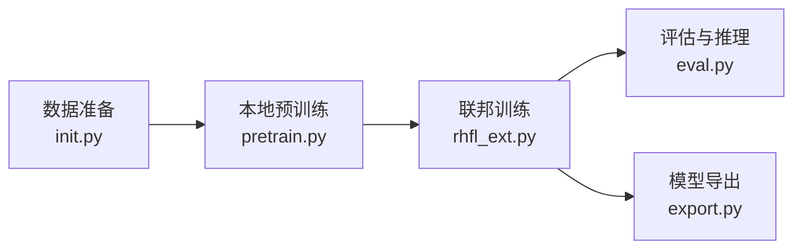

# FedSteller：基于MindSpore的国产化联邦学习框架


FedSteller 是项目「基于MindSpore的国产化联邦学习框架」的代码实现。框架基于国产深度学习框架昇思 MindSpore 开发，在昇腾 Ascend 910 AI 处理器上完成训练、评估与模型导出，面向参与方模型结构异构、本地数据含有标签噪声的联邦学习场景。框架的核心算法来自鲁棒异构联邦学习方法 RHFL [1] 及其扩展版本 RHFL+ [2]。

## 主要特性

- 国产软硬件平台：网络定义、数据加载、训练、评估与模型导出均使用 MindSpore 接口实现，已在 MindSpore 1.8.1 与 Ascend 910 上完成验证；训练得到的模型可导出为 MindIR 和 AIR 格式，用于昇腾平台的推理部署。
- 模型异构的联邦协作：各参与方使用各自的网络结构，默认配置为 ResNet10、ResNet12、ShuffleNet 和 EfficientNet。参与方之间交换模型在公共数据集上的输出分布，私有数据与模型参数保留在本地。
- 标签噪声鲁棒训练：框架内置 pairflip 与 symmetric 两种标签噪声模拟。本地训练采用对称交叉熵损失（SCE）抑制噪声标签的影响；客户端置信度重加权（CCR）依据各参与方私有数据损失的相对下降量分配协作权重，降低含噪参与方对其他参与方的影响。
- 完整的实验流程：仓库提供数据初始化、本地预训练、联邦训练、评估与模型导出脚本，超参数集中在 `config.yaml` 中配置。

## 国产软硬件适配

| 层次 | 组件 | 用途 |
| --- | --- | --- |
| 深度学习框架 | 昇思 MindSpore 1.8.1 | 网络定义、数据管道、训练、评估与模型导出 |
| 模型库 | mindvision 0.1.0 | ResNet10 / ResNet12 骨干网络与损失监控 |
| AI 处理器 | 昇腾 Ascend 910 | 本地预训练、联邦训练与评估 |
| 模型格式 | ckpt、MindIR、AIR | 模型保存、推理与昇腾部署 |

网络与数据管道分别基于 `mindspore.nn` 与 `mindspore.dataset` 实现。`.ckpt` 文件用于训练与评估；MindIR 文件可由 MindSpore 与 MindSpore Lite 加载推理；AIR 文件可经 ATC 工具转换为 OM 模型，部署到昇腾推理设备。

## 方法概述

框架在单机上模拟 N 个参与方（默认 N = 4）。每个参与方从 CIFAR-10 训练集中随机抽取私有数据，并按设定的噪声类型和噪声率注入标签噪声；公共数据集取自 CIFAR-100 训练集的随机子集，协作过程中仅使用其图像。整体流程如下：



各参与方先在私有数据上独立预训练，随后进入联邦训练。每一轮通信依次执行以下步骤：

1. 评估：在 CIFAR-10 测试集上评估各参与方模型。
2. 客户端置信度重加权（CCR）：计算各参与方在私有数据上的平均 SCE 损失，以相邻两轮损失的相对下降量衡量该参与方的数据质量，归一化后经指数归一化得到协作权重；第一轮使用均匀权重。
3. 异构协作学习：各参与方在公共数据上输出 softmax 分布，以其他参与方的输出分布为目标、按协作权重计算 KL 散度损失，使结构不同的模型在 logits 输出分布上相互对齐。
4. 本地学习：各参与方以 SCE 损失在私有数据上训练，本地 epoch 数为私有数据量与公共数据量之比（向下取整，最小为 1）。
5. 保存：每 5 轮及最后一轮保存各参与方的 checkpoint；学习率每轮乘以 0.96。

## 目录结构

```text
FedSteller
├── config.yaml          训练、评估与导出参数
├── init.py              下载并初始化 CIFAR-10 / CIFAR-100
├── pretrain.py          各参与方本地预训练
├── rhfl_ext.py          联邦训练主脚本
├── eval.py              模型评估与推理
├── export.py            导出 MindIR 与 AIR 模型
├── loss.py              SCE 损失与 KL 散度损失
└── src
    ├── cifar.py         CIFAR 数据读取与标签噪声生成
    ├── init_data.py     参与方数据集封装
    ├── utils.py         日志、数据加载与模型构建
    ├── resnet.py        ResNet10 / ResNet12
    ├── shufflenet.py    ShuffleNet
    └── efficientnet.py  EfficientNet
```

## 环境要求

- 硬件：昇腾 Ascend 910 AI 处理器，并安装配套的驱动、固件与 CANN 软件包。
- 框架：MindSpore 1.8.1（Ascend 版本），安装方法见 [MindSpore 安装指南](https://www.mindspore.cn/install)，历史版本见 [MindSpore 版本列表](https://www.mindspore.cn/versions)。
- 其他依赖：mindvision 0.1.0、PyYAML、NumPy、Pillow、six。

```shell
pip install mindvision==0.1.0 pyyaml six
```

代码中的数据增强使用 MindSpore 1.x 的 `py_transforms` 接口，ResNet 结构来自 mindvision 0.1.0，建议按上述版本配置环境。参考文档：[MindSpore 1.8 教程](https://www.mindspore.cn/tutorials/zh-CN/r1.8/index.html)、[MindSpore 1.8 文档](https://www.mindspore.cn/docs/zh-CN/r1.8/index.html)。

## 数据准备

| 数据集 | 用途 | 类别数 | 训练集 | 测试集 |
| --- | --- | --- | --- | --- |
| [CIFAR-10](https://www.cs.toronto.edu/~kriz/cifar.html) | 参与方私有数据与模型评估 | 10 | 50,000 张 | 10,000 张 |
| [CIFAR-100](https://www.cs.toronto.edu/~kriz/cifar.html) | 公共数据（仅使用图像） | 100 | 50,000 张 | 10,000 张 |

两个数据集均由 32×32 的彩色图像组成，以 Python pickle 格式存储。运行 `python init.py` 会将数据集下载并解压到 `src/datasets/`；也可以手动下载 [cifar-10-python.tar.gz](https://www.cs.toronto.edu/~kriz/cifar-10-python.tar.gz) 与 [cifar-100-python.tar.gz](https://www.cs.toronto.edu/~kriz/cifar-100-python.tar.gz)，解压到该目录，脚本校验文件完整后会跳过下载。目录结构如下：

```text
src/datasets
├── cifar-10-batches-py
│   ├── batches.meta
│   ├── data_batch_1
│   ├── data_batch_2
│   ├── data_batch_3
│   ├── data_batch_4
│   ├── data_batch_5
│   ├── readme.html
│   └── test_batch
└── cifar-100-python
    ├── file.txt~
    ├── meta
    ├── test
    └── train
```

## 快速开始

所有脚本均在仓库根目录下运行，脚本通过相对路径读取 `config.yaml`、数据集与 checkpoint。

```shell
# 1. 下载并初始化数据集
python init.py
# 2. 各参与方在私有数据上预训练
python pretrain.py
# 3. 联邦训练
python rhfl_ext.py
# 4. 评估联邦训练后的模型
python eval.py
# 5. 导出 MindIR 与 AIR 模型
python export.py
```

## 参数配置

训练、评估与导出参数在 `config.yaml` 中设置：

| 参数 | 默认值 | 说明 |
| --- | --- | --- |
| `n_participants` | 4 | 参与方数量 |
| `noise_type` | `pairflip` | 标签噪声类型，可选 `pairflip`、`symmetric`；设为 `null` 表示使用干净标签 |
| `noise_rate` | 0.1 | 标签噪声率 |
| `pretrain.train_batch_size` | 1024 | 预训练 batch 大小 |
| `pretrain.test_batch_size` | 512 | 预训练阶段的测试 batch 大小 |
| `pretrain.pretrain_epoch` | 80 | 每个参与方的预训练 epoch 数 |
| `pretrain.private_data_len` | 50000 | 预训练阶段每个参与方的私有数据量 |
| `pretrain.pariticpant_params.loss_funnction` | `SCE` | 损失函数，可选 `CE`、`SCE` |
| `pretrain.pariticpant_params.optimizer_name` | `Adam` | 优化器，可选 `Adam`、`SGD` |
| `pretrain.pariticpant_params.learning_rate` | 0.001 | 预训练学习率 |
| `rhfl.train_batch_size` | 512 | 联邦训练 batch 大小 |
| `rhfl.test_batch_size` | 512 | 联邦训练阶段的测试 batch 大小 |
| `rhfl.communication_epoch` | 40 | 通信轮数 |
| `rhfl.private_data_len` | 10000 | 联邦训练阶段每个参与方的私有数据量 |
| `rhfl.public_dataset_length` | 5000 | 公共数据集大小 |
| `rhfl.pariticpant_params.loss_funnction` | `SCE` | 本地训练损失函数，可选 `CE`、`SCE` |
| `rhfl.pariticpant_params.optimizer_name` | `Adam` | 本地训练优化器，可选 `Adam`、`SGD` |
| `rhfl.pariticpant_params.learning_rate` | 0.002 | 联邦训练初始学习率 |

以下设置在代码中指定：

- 参与方模型列表 `["ResNet10", "ResNet12", "ShuffleNet", "EfficientNet"]` 分别定义在 `pretrain.py`、`rhfl_ext.py`、`eval.py` 与 `export.py` 中，修改 `n_participants` 时需同步修改该列表。
- SCE 损失的系数为 α = 0.4、β = 1.0，在各脚本实例化 `SCELoss` 时指定。
- CCR 由 `rhfl_ext.py` 中的 `CLIENT_CONFIDENCE_REWEIGHT`（默认 `True`）控制，权重系数 `BETA = 0.5`。
- `rhfl_ext.py` 从 `Model_Storage/pretrain/` 加载预训练模型，加载路径由 `rhfl` 部分的 `loss_funnction` 决定，因此 `pretrain` 与 `rhfl` 两部分的 `loss_funnction` 需保持一致。

## 训练

在 Ascend 910 上依次运行预训练与联邦训练：

```shell
python pretrain.py
python rhfl_ext.py
```

输出文件：

- 预训练 checkpoint：`Model_Storage/pretrain/<损失函数>/<噪声类型><噪声率>/<网络名>_<参与方序号>.ckpt`，例如 `Model_Storage/pretrain/SCE/pairflip0.1/ResNet10_0.ckpt`。
- 联邦训练 checkpoint：`Model_Storage/RHFL/<损失函数>/<噪声类型><噪声率>/`，每 5 轮及最后一轮保存一次。
- 日志：`Logs/<脚本名>.log`，例如 `Logs/rhfl_ext.log`，每次运行覆盖同名日志。

联邦训练过程日志：

```log
2023-03-22 15:01:08,237 - rhfl_ext.py[line:148] - INFO: Random Seed and Server Config
2023-03-22 15:01:08,240 - rhfl_ext.py[line:152] - INFO: Initialize Participants' Data idxs and Model
2023-03-22 15:01:08,248 - rhfl_ext.py[line:158] - INFO: {0: array([11841, 19602, 45519, ..., 47278, 37020,  2217]), 1: array([28921, 11971, 15919, ..., 46749, 41193, 22418]), 2: array([36011, 11643, 45353, ..., 42473, 40043, 26550]), 3: array([ 8777,  6584, 42707, ..., 25134, 39808, 32076])}
2023-03-22 15:01:10,502 - rhfl_ext.py[line:161] - INFO: Load Participants' Models
2023-03-22 15:01:11,111 - rhfl_ext.py[line:172] - INFO: Initialize Public Data Parameters
```

联邦训练结束时，脚本输出 4 个参与方模型在 CIFAR-10 测试集上的准确率：

```log
2023-03-22 15:01:21,158 - rhfl_ext.py[line:356] - INFO: Final Evaluate Models
2023-03-22 15:02:01,005 - rhfl_ext.py[line:105] - INFO: Test: Accuracy: 77.1%, Avg loss: 2.888967
2023-03-22 15:02:16,866 - rhfl_ext.py[line:105] - INFO: Test: Accuracy: 77.2%, Avg loss: 2.835910
2023-03-22 15:03:01,027 - rhfl_ext.py[line:105] - INFO: Test: Accuracy: 68.5%, Avg loss: 3.767210
2023-03-22 15:03:33,415 - rhfl_ext.py[line:105] - INFO: Test: Accuracy: 76.8%, Avg loss: 2.708377
```

## 评估与推理

```shell
python eval.py
```

`eval.py` 加载联邦训练保存的 checkpoint，在 CIFAR-10 测试集上评估各参与方模型，结果写入 `Logs/eval.log`：

```log
2023-03-25 14:53:21,628 - eval.py[line:78] - INFO: Load Participants' Models
2023-03-25 14:53:22,198 - eval.py[line:93] - INFO: Final Evaluate Models
2023-03-25 14:54:01,454 - eval.py[line:69] - INFO: Test: Accuracy: 77.1%, Avg loss: 2.888967
2023-03-25 14:54:18,234 - eval.py[line:69] - INFO: Test: Accuracy: 77.2%, Avg loss: 2.835910
2023-03-25 14:55:04,642 - eval.py[line:69] - INFO: Test: Accuracy: 68.5%, Avg loss: 3.767210
2023-03-25 14:55:40,091 - eval.py[line:69] - INFO: Test: Accuracy: 76.8%, Avg loss: 2.708377
```

## 模型导出

```shell
python export.py
```

`export.py` 将联邦训练后的模型导出为 MindIR 与 AIR 两种格式，输出到 `Model_Storage/<损失函数>/<噪声类型><噪声率>/`。导出时的输入张量形状为 (32, 3, 224, 224)，可在 `export.py` 中修改。AIR 格式需要在 Ascend 环境中导出。

```log
2023-03-25 15:01:52,038 - export.py[line:45] - INFO: Load Participants' Models
2023-03-25 15:01:54,673 - export.py[line:64] - INFO: ResNet10_0model exported successfully
2023-03-25 15:01:56,260 - export.py[line:64] - INFO: ResNet12_1model exported successfully
2023-03-25 15:02:04,916 - export.py[line:64] - INFO: ShuffleNet_2model exported successfully
2023-03-25 15:02:11,037 - export.py[line:64] - INFO: EfficientNet_3model exported successfully
2023-03-25 15:02:11,040 - export.py[line:66] - INFO: Models exported successfully
```

## 性能

### 训练性能

| 参数 | Ascend 910 |
| --- | --- |
| 参与方模型 | ResNet10、ResNet12、ShuffleNet、EfficientNet |
| 资源 | NPU：1 × Ascend 910；CPU：24 核；显存：32 GB；内存：256 GB |
| 测试日期 | 2023-03-25 |
| MindSpore 版本 | 1.8.1 |
| 数据集 | CIFAR-10（私有数据）、CIFAR-100（公共数据） |
| 训练参数 | train_batch_size = 512，test_batch_size = 512，communication_epoch = 40 |
| 优化器 | Adam |
| 损失函数 | SCE |
| 测试集平均损失 | 3.050116（4 个参与方的平均值） |
| 速度 | 1700 ms/step |
| 总耗时 | 约 7 小时 |
| checkpoint 大小 | 56.9 MB（4 个 .ckpt 文件） |

### 推理性能

| 参数 | Ascend 910 |
| --- | --- |
| 参与方模型 | ResNet10、ResNet12、ShuffleNet、EfficientNet |
| 资源 | NPU：1 × Ascend 910；CPU：24 核；显存：32 GB；内存：256 GB |
| 测试日期 | 2023-03-25 |
| MindSpore 版本 | 1.8.1 |
| 数据集 | CIFAR-10 测试集 |
| batch_size | 512 |
| 准确率 | 74.9075%（4 个参与方的平均值，各参与方分别为 77.1%、77.2%、68.5%、76.8%） |
| 推理模型大小 | 56.9 MB（4 个 .air 文件） |

## 随机性说明

`src/utils.py`、`pretrain.py` 与 `rhfl_ext.py` 中设置了 `random.seed(0)` 与 `np.random.seed(0)`，参与方私有数据的划分与公共数据的抽样由该种子确定；标签噪声由 `src/cifar.py` 中固定的 `random_state=0` 生成。

## 算法来源与引用

本框架的核心算法来自以下工作。MindSpore 实现基于 [FangXiuwen/Robust_FL_mindspore](https://github.com/FangXiuwen/Robust_FL_mindspore)，PyTorch 实现见 [FangXiuwen/Robust_FL](https://github.com/FangXiuwen/Robust_FL)。

[1] Xiuwen Fang, Mang Ye. Robust Federated Learning with Noisy and Heterogeneous Clients. In 2022 IEEE/CVF Conference on Computer Vision and Pattern Recognition (CVPR), pp. 10062–10071, 2022. DOI: [10.1109/CVPR52688.2022.00983](https://doi.org/10.1109/CVPR52688.2022.00983)

[2] Xiuwen Fang, Mang Ye. Noise-Robust Federated Learning With Model Heterogeneous Clients. IEEE Transactions on Mobile Computing, 24(5): 4053–4071, 2025. DOI: [10.1109/TMC.2024.3522573](https://doi.org/10.1109/TMC.2024.3522573)

```bibtex
@inproceedings{fang2022robust,
  title     = {Robust Federated Learning with Noisy and Heterogeneous Clients},
  author    = {Fang, Xiuwen and Ye, Mang},
  booktitle = {2022 IEEE/CVF Conference on Computer Vision and Pattern Recognition (CVPR)},
  pages     = {10062--10071},
  year      = {2022},
  doi       = {10.1109/CVPR52688.2022.00983}
}

@article{fang2025noise,
  title   = {Noise-Robust Federated Learning With Model Heterogeneous Clients},
  author  = {Fang, Xiuwen and Ye, Mang},
  journal = {IEEE Transactions on Mobile Computing},
  volume  = {24},
  number  = {5},
  pages   = {4053--4071},
  year    = {2025},
  doi     = {10.1109/TMC.2024.3522573}
}
```

## 许可证

本仓库代码遵循 Apache License 2.0，见各源文件头部的版权声明。
